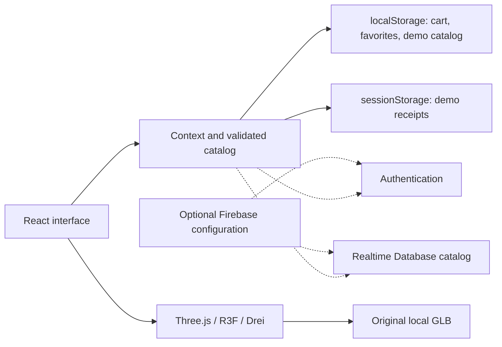

<p align="center">
  
</p>

<h1 align="center">Rua 7 · Streetwear, motion & 3D</h1>

<p align="center">An experimental storefront built for portfolio, learning and exploring new web technologies.</p>

<p align="center">
  <a href="README.pt-BR.md">Português (Brasil)</a> ·
  <a href="#getting-started">Getting started</a> ·
  <a href="#animation-and-3d">Animation & 3D</a> ·
  <a href="#project-status">Project status</a>
</p>

[](https://github.com/C4rlossz/rua-7/actions/workflows/ci.yml)


<details>
  <summary>Mobile preview</summary>
  <p></p>
</details>

## About the project

**Rua 7 is a personal portfolio and technology playground by Carlos Eduardo.** It brings together a purple-and-white streetwear identity, a responsive shopping interface, animated product exploration and an original 3D sneaker.

The goal is to practice frontend development, experiment with libraries and interactions, understand browser-based 3D, and test the decisions behind an ecommerce-style experience. The brand, catalog and shopping flow provide a concrete setting for those experiments.

**The checkout is a simulation.** It does not charge customers, dispatch products or reserve stock. Product prices, availability and sizes are sample data. Firebase integration is optional and requires a project owned and configured by the developer. The application interface is currently in **Brazilian Portuguese**; the documentation is available in English and Portuguese.

## What you can explore

| Area | Implemented experience |
|---|---|
| Brand and homepage | Rua 7 visual identity, editorial campaign, animated headlines, product cards and a pausable scrolling strip |
| Catalog | Five sample products: two sneakers, a sweatshirt, trousers and a cap; category/size filters and sorting |
| Product detail | Image thumbnails, six original views of the featured sneaker, expanded gallery, size selection and favorites |
| Interactive 3D | Rotate, zoom and reset the original sneaker; optional automatic rotation and keyboard controls |
| Cart | Product variations, quantities, stock limits and totals calculated in integer cents |
| Demo checkout | Contact/address examples, review step and a local receipt without payment processing |
| Customer access | Sign-in, registration and password-reset interfaces prepared for Firebase Authentication |
| Admin access | Separate sign-in and product-management interface, plus a local demonstration mode |
| Transparency | Privacy, terms, storage, accessibility, contact and data-rights pages adapted to the demonstration |

Only the featured **Rua 7 Movimento 01** sneaker currently has a 3D model. Other catalog entries contain placeholders or illustrative artwork.

## Technology stack

Versions below describe the existing lockfile snapshot. `package-lock.json` is the source of truth for a reproducible installation.

| Technology | Version | Role in this project |
|---|---:|---|
| React / React DOM | 19.3.1 | Component-based UI, hooks, context and state |
| JavaScript | ES modules / JSX | Application and tooling code |
| Vite | 7.x | Development server, production build and code splitting |
| React Router | 7.18.4 | Client-side pages, navigation and route parameters |
| Motion | 12.43.0 | Entrance animations, scroll reveals, gallery transitions and toast animation; imported from `motion/react` |
| Three.js | 0.180.0 | Geometry, materials, lighting, GLB export and WebGL rendering |
| React Three Fiber | 9.8.2 | React integration for the Three.js scene and canvas |
| Drei | 10.7.9 | `OrbitControls`, GLB loading, centering and contact shadows |
| Firebase JavaScript SDK | 12.19.0 | Optional Authentication and Realtime Database integration |
| CSS | Custom styles | Responsive layout, hover/focus states, animated ticker and reduced-motion rules |
| Lucide React | 0.468.0 | Interface icons |
| Fontsource | 5.3.0 | Locally served Inter and Barlow Condensed fonts |
| Node.js test runner | Built into Node | Unit and regression tests |
| axe-core / Lighthouse | Development dependencies | Local accessibility and performance inspection |
| GitHub Actions | `Quality` workflow | Clean install, tests, dependency checks, notices, source scan and build |

No CSS component framework or payment gateway is required to run the demo. Playwright is present as a development dependency; the repository does not currently provide a fully automated browser E2E suite.

## Animation and 3D

### Interface motion

- **Motion** drives the homepage entrance, product-card reveals, notifications and transitions between product images.
- **`AnimatePresence`** coordinates gallery entry/exit with opacity, scale and a slight `rotateY` effect. These transitions are distinct from the actual 3D object.
- **CSS** handles the scrolling brand strip, hover feedback and focus transitions. The strip has a pause control.
- **Reduced motion** is respected through Motion configuration, `useReducedMotion` and CSS media queries. Automatic model rotation starts disabled.

### A real object in the browser

The featured sneaker is an **original, illustrative, procedurally modeled GLB**, with geometry, materials, laces, sole and other details. It is not a photogrammetry scan or a dimensionally accurate representation of a physical product. Its six gallery images are renderings of that same concept.

`src/model360.jsx` renders the model using React Three Fiber and Three.js. Drei provides camera interaction and scene helpers. The 3D module loads on demand when the visitor chooses the 3D view. The canvas uses demand-based rendering and a bounded pixel ratio to limit unnecessary work.

| Interaction | Control |
|---|---|
| Rotate | Drag the object or use the rotation buttons |
| Zoom | Mouse wheel, configured touch gestures or the + / − buttons |
| Keyboard rotation | Arrow keys while the model container is focused |
| Keyboard zoom | `+`, `=` and `-` |
| Reset | `Home` or the reset button |
| Automatic turntable | Explicit play/pause control |
| Alternative view | Switch back to the image gallery |

Touch interaction is configured in `OrbitControls`; responsive viewport checks do not replace testing on physical phones. The current GLB is uncompressed, and optional Draco/Meshopt decoders are disabled to avoid unnecessary remote/WASM initialization under the content security policy.

The geometry generator is available for study:

```sh
node scripts/build-original-model.mjs
```

It writes `public/models/rua7-movimento-v2.glb`. Gallery renders are separate files; changing the model does not regenerate those PNGs automatically. The local development page `/tools/model-preview.html?view=side` helps inspect it, with additional `pair`, `inner`, `rear`, `top` and `sole` views.

## Getting started

### Requirements

- Node.js **22.12+** or **24.x**; the recorded local checks used Node 24.
- npm and Git.
- A modern browser with WebGL support for the 3D view. The image gallery remains available as an alternative.

```sh
git clone https://github.com/C4rlossz/rua-7.git
cd rua-7
npm ci
npm run dev
```

Open the local address printed by Vite, normally `http://127.0.0.1:5173`. A Firebase account or environment file is **not required** for the local demonstration.

### Try the shopping flow

1. Open the collection and select **Rua 7 Movimento 01**.
2. Explore the thumbnails and switch between photos and 3D.
3. Choose a size, then use **Comprar agora** or add the item to the cart.
4. In checkout, click **Preencher exemplo** to use fictional data.
5. Review the summary and finish the demonstration. No payment or shipment is created.

### Try the local admin demo

Open `/admin/login` and select **Explorar painel demonstrativo** while Firebase is unconfigured. You can inspect the dashboard and edit the local catalog. This mode changes browser data only; it does not create an administrator or grant access to a server.

There are no hardcoded administrator credentials. Real credential fields stay disabled until Firebase configuration is present.

## Optional Firebase configuration

The code integrates **Firebase Authentication** and **Realtime Database**, not Firestore. Supplying configuration does not create a Firebase project or deploy database rules automatically.

1. Create/select your own Firebase project and register a web app.
2. Copy `.env.example` to `.env.local`.
3. Fill in the public web-app configuration from your project:

```dotenv
VITE_FIREBASE_API_KEY=
VITE_FIREBASE_AUTH_DOMAIN=
VITE_FIREBASE_PROJECT_ID=
VITE_FIREBASE_APP_ID=
VITE_FIREBASE_DATABASE_URL=
VITE_TRUSTED_ASSET_ORIGINS=
```

4. Enable the email/password sign-in provider, configure authorized domains and provision Realtime Database.
5. Review, test and deploy `database.rules.json` to the intended project.
6. Assign the boolean custom claim `admin: true` using a trusted server-side process. Administrative access also requires a verified email.
7. Restart the development server after editing environment variables.

**All `VITE_*` values become visible in the browser.** Never put service-account credentials, Admin SDK secrets or private keys in them. The public Firebase configuration is not a replacement for authorization rules. Authentication uses session persistence; real sign-in, password recovery and remote catalog access still need validation against the chosen project.

`VITE_TRUSTED_ASSET_ORIGINS` is empty by default. Approving external media requires coordinated changes to the resource policy, CSP and database rules; setting this variable alone does not enable unrestricted downloads.

## Scripts and checks

| Command | Purpose |
|---|---|
| `npm run dev` | Start the local development server |
| `npm test` | Run the existing unit/regression tests |
| `npm run build` | Generate the production bundle in `dist/` |
| `npm run preview` | Serve the compiled application locally |
| `npm run notices` | Generate dependency notices and the license inventory |
| `npm run audit:source` | Scan supported text files and reachable Git history for known secret patterns |
| `npm audit --audit-level=high` | Check the lockfile against known dependency advisories |
| `npm run release:prepare` | Create a clean source export under `exports/`; it does not push or deploy |

The source scanner is pattern-based and is not proof that every possible secret is absent. Generated export folders are intentionally not overwritten by the export script.

The audit recorded on **October 27, 2026** includes **17 passing tests** and accessibility checks of selected states. Those results describe that execution, not permanent coverage or a certification. Current CI results are available in the repository's **Actions** tab. Browser checks, physical-device testing and real Firebase verification have separate limits documented in the audit.

## Project structure

```text
src/
  App.jsx                 Routes and application shell
  Home.jsx                Homepage, collection and favorites
  ProductPage.jsx         Product details and size selection
  ProductViewer.jsx       Gallery, transitions and 3D switching
  model360.jsx            Three.js scene and controls
  Checkout.jsx            Cart, demo checkout and receipt
  AuthPages.jsx           Customer and administrator access
  Admin.jsx               Demo/authorized product management
  store.jsx               Shared application state
  catalog.js              Sample products and validation
  firebase*.js            Optional Firebase configuration/client
  LegalPages.jsx          Transparency and contact interfaces
  site-info.json          Brand, author and contact settings
public/
  images/                 Original concept renders and campaign assets
  models/                 Featured sneaker GLB
scripts/                  Geometry, inventories and export tools
tests/                    Node.js tests
qa/                       Desktop and mobile screenshots
docs/                     Architecture, operations and policy documents
audit/                    Dated reports, risks and available evidence
.github/workflows/ci.yml   Quality workflow
```

### Data and architecture



Checkout contact/address fields remain in form memory and are not included in the saved demo receipt. Receipts are limited to the session and the most recent 100 entries. Cart/favorites/catalog data stay local until cleared. `/cookies` provides a control for clearing the application's local data; it does not delete an account from a remote provider.

## Main routes

| Route | Page |
|---|---|
| `/`, `/colecao` | Homepage and collection |
| `/produto/tenis-floral` | Featured sneaker; the legacy URL identifier is retained |
| `/favoritos`, `/sacola` | Favorites and cart |
| `/checkout`, `/pedido/:id` | Simulated checkout and session receipt |
| `/login` | Customer access |
| `/admin/login`, `/admin` | Administrator access and dashboard |
| `/privacidade`, `/termos`, `/cookies` | Privacy, terms and local storage |
| `/direitos`, `/acessibilidade`, `/atendimento` | Rights, accessibility and contact |

## Project status

- **Available locally:** storefront, sample catalog, size selection, cart, favorites, gallery, original 3D, demo checkout, admin demo and documentation pages.
- **Configuration-dependent:** real authentication and remote catalog changes through Firebase. Their production configuration is not included or claimed as verified.
- **Intentionally outside this experiment:** real payments, fulfillment, transactional inventory, commercial ordering and automatic contact-email delivery.
- **Further validation:** assistive technologies, physical phones, provider settings, operational processes and production security review.

The contact/rights forms prepare a local email draft or text file. The visitor must send the draft through their own email application; the site does not report a message as delivered just because a draft exists.

## Building and hosting

```sh
npm run build
npm run preview
```

To host the demo, serve `dist/` and configure SPA fallback to `index.html` for page routes. `firebase.json` contains a classic Firebase Hosting example and local database rules; `_headers` and the Vite preview define security-header examples. Confirm the actual hosting platform applies them.

Publishing this source repository does not deploy the storefront, provision Firebase or enable sales. GitHub Pages is not preconfigured: its subpath/base-URL and routing requirements need separate work. Demo indexing remains disabled intentionally; commercial SEO, canonical URLs and sitemap are not presented as production-ready.

## Accessibility, security and assets

The interface includes keyboard controls, visible focus, a skip link, labels, native dialogs, reduced-motion handling and an image alternative to WebGL. Automated checks cover selected states and do not certify full WCAG conformance.

Resource URLs are restricted by default. Product data, prices, stock, stored cart entries and receipts are validated. Firebase authorization depends on server-issued claims and deployed rules, not on hiding an admin link. See [SECURITY.md](SECURITY.md) before connecting real services.

The featured sneaker uses original geometry and renders. Campaign/brand images created with AI assistance are identified in [ASSETS.md](ASSETS.md). Assets and trademarks have separate conditions; generated content does not imply exclusive rights or trademark registration. Third-party libraries and fonts retain their own licenses and notices.

This public source snapshot excludes the old private Git history, unlicensed reference photos and the earlier model that embedded them.

## Documentation and contributions

- [Portuguese README](README.pt-BR.md)
- [Architecture](docs/ARCHITECTURE.md)
- [Security policy](SECURITY.md)
- [Contribution guidelines](CONTRIBUTING.md)
- [Changelog](CHANGELOG.md)
- [Asset provenance and license scope](ASSETS.md)
- [Audit overview](audit/00-executivo.md) and [test report](audit/06-testes.md)
- [Operational/commercial readiness checklist](audit/09-checklist-publicacao.md)

Supporting audit and policy documents are primarily in Portuguese. They are dated records, and pending items should not be interpreted as completed integrations. Suggestions and experiments are welcome; preserve the demo status and document new dependencies or data collection.

## Author and license

**Carlos Eduardo · [@C4rlossz](https://github.com/C4rlossz)**<br />
Project contact: **Carloseduardo1402@gmail.com**

Original project code is released under the [MIT License](LICENSE). Third-party components keep their own licenses. The code license does not automatically license the Rua 7 brand or every visual asset; see [ASSETS.md](ASSETS.md) and [third-party notices](public/third-party-notices.txt).

**Built to learn, experiment and demonstrate web-development skills.**
