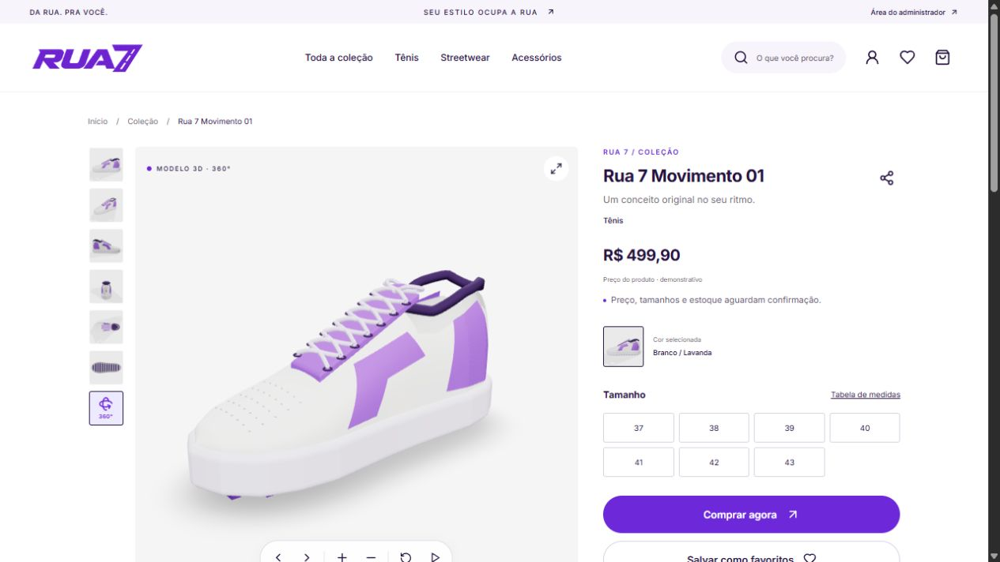
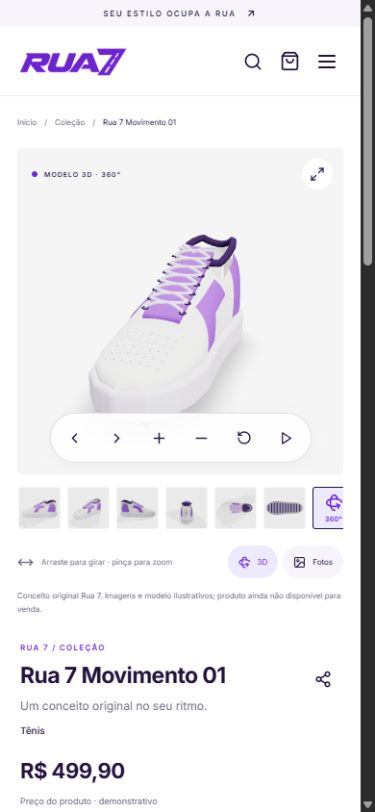
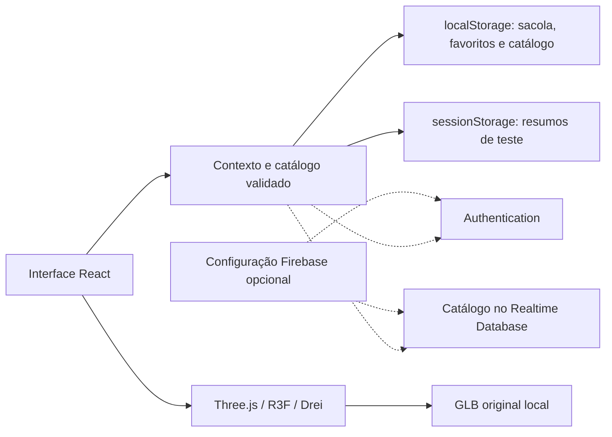

<p align="center">
  
</p>

<h1 align="center">Rua 7 · Streetwear, animação e 3D</h1>

<p align="center">Uma loja experimental criada para portfólio, aprendizado e exploração de novas tecnologias web.</p>

<p align="center">
  <a href="README.md">English</a> ·
  <a href="#como-executar">Como executar</a> ·
  <a href="#animações-e-3d">Animações e 3D</a> ·
  <a href="#estado-do-projeto">Estado do projeto</a>
</p>

[](https://github.com/C4rlossz/rua-7/actions/workflows/ci.yml)



<details>
  <summary>Prévia no celular</summary>
  <p></p>
</details>

## Sobre o projeto

**A Rua 7 é um projeto pessoal de portfólio e experimentação tecnológica de Carlos Eduardo.** A proposta reúne uma identidade visual roxa e branca, uma interface responsiva de streetwear, exploração animada de produtos e um tênis original em 3D.

O objetivo é praticar desenvolvimento frontend, testar bibliotecas e interações, estudar visualização 3D no navegador e compreender as decisões por trás de uma experiência de ecommerce. A marca, o catálogo e o fluxo de compra servem como contexto prático para esses estudos.

**O checkout é uma simulação.** Não há cobrança, envio de mercadorias ou reserva real de estoque. Preços, tamanhos e disponibilidade são dados de exemplo. A integração com Firebase é opcional e exige um projeto configurado pelo desenvolvedor. A interface da aplicação está em **português brasileiro**; a documentação está disponível em português e inglês.

## O que você pode explorar

| Área | Experiência implementada |
|---|---|
| Marca e página inicial | Identidade Rua 7, campanha editorial, entradas animadas, cards e faixa de texto com pausa |
| Catálogo | Cinco produtos de exemplo: dois tênis, uma blusa, uma calça e um boné; filtros de categoria/tamanho e ordenação |
| Página do produto | Miniaturas, seis vistas originais do tênis principal, galeria ampliada, escolha de tamanho e favoritos |
| 3D interativo | Rotação, zoom e restauração do tênis original; giro automático opcional e controles de teclado |
| Sacola | Variações, quantidades, limites de estoque e valores calculados em centavos inteiros |
| Checkout demonstrativo | Dados fictícios, revisão e resumo local sem processamento de pagamento |
| Acesso do cliente | Telas de login, cadastro e recuperação de senha preparadas para Firebase Authentication |
| Administração | Entrada separada, interface de gerenciamento e modo de demonstração local |
| Transparência | Páginas de privacidade, termos, armazenamento, acessibilidade, atendimento e direitos adaptadas à demonstração |

Somente o tênis principal, **Rua 7 Movimento 01**, possui modelo 3D neste momento. Os outros itens usam espaços reservados ou imagens ilustrativas.

## Tecnologias utilizadas

As versões abaixo descrevem o snapshot do lockfile existente. O `package-lock.json` é a referência para instalações reproduzíveis.

| Tecnologia | Versão | Aplicação no projeto |
|---|---:|---|
| React / React DOM | 19.3.1 | Interface por componentes, hooks, contexto e estado |
| JavaScript | ES modules / JSX | Código da aplicação e ferramentas |
| Vite | 7.x | Servidor de desenvolvimento, build e separação de código |
| React Router | 7.18.4 | Páginas, navegação e parâmetros de rota |
| Motion | 12.43.0 | Entradas, revelação dos cards, transições da galeria e notificações; importado por `motion/react` |
| Three.js | 0.180.0 | Geometria, materiais, iluminação, exportação GLB e renderização WebGL |
| React Three Fiber | 9.8.2 | Integração da cena Three.js com React |
| Drei | 10.7.9 | `OrbitControls`, carregamento de GLB, centralização e sombras de contato |
| Firebase JavaScript SDK | 12.19.0 | Integração opcional com Authentication e Realtime Database |
| CSS | Estilos próprios | Layout responsivo, hover/foco, faixa animada e redução de movimento |
| Lucide React | 0.468.0 | Ícones da interface |
| Fontsource | 5.3.0 | Fontes Inter e Barlow Condensed servidas localmente |
| Test runner do Node.js | Integrado ao Node | Testes unitários e de regressão |
| axe-core / Lighthouse | Dependências de desenvolvimento | Inspeções locais de acessibilidade e desempenho |
| GitHub Actions | Workflow `Quality` | Instalação limpa, testes, dependências, avisos, busca de segredos e build |

Não é necessário um framework de componentes CSS nem gateway de pagamento para executar a demonstração. Playwright consta nas dependências de desenvolvimento; o repositório ainda não oferece uma suíte completa de testes E2E automatizados no navegador.

## Animações e 3D

### Movimento na interface

- **Motion** controla a entrada da página inicial, revelação dos cards, notificações e troca de imagens do produto.
- **`AnimatePresence`** coordena entrada e saída da galeria com opacidade, escala e uma leve rotação `rotateY`. Essas transições são separadas do objeto 3D real.
- **CSS** cuida da faixa animada da marca e dos estados de hover e foco. A faixa possui controle de pausa.
- **Redução de movimento:** preferências do sistema são consideradas pela configuração do Motion, por `useReducedMotion` e por media queries. O giro automático do modelo começa desligado.

### Um objeto real no navegador

O tênis principal é um **GLB original e ilustrativo, criado por modelagem procedural**, com geometria, materiais, cadarços, solado e outros detalhes. Não é um escaneamento por fotogrametria nem uma representação dimensional exata de um produto físico. As seis imagens da galeria são renderizações desse mesmo conceito.

O arquivo `src/model360.jsx` renderiza o objeto com React Three Fiber e Three.js. O Drei fornece os controles de câmera e auxiliares da cena. O módulo 3D só é carregado quando o visitante escolhe essa visualização. O canvas usa renderização sob demanda e limite de densidade de pixels para reduzir trabalho desnecessário.

| Interação | Controle |
|---|---|
| Girar | Arrastar o objeto ou usar os botões de rotação |
| Aproximar/afastar | Roda do mouse, gestos de toque configurados ou botões + / − |
| Girar por teclado | Setas com o contêiner do modelo em foco |
| Zoom por teclado | `+`, `=` e `-` |
| Restaurar | Tecla `Home` ou botão de restauração |
| Giro automático | Controle explícito de iniciar/pausar |
| Visualização alternativa | Retornar à galeria de imagens |

Os gestos de toque estão configurados no `OrbitControls`; testes de responsividade não substituem validação em celulares físicos. O GLB atual não usa compressão, e decodificadores opcionais Draco/Meshopt estão desativados para evitar inicialização desnecessária de recursos remotos/WASM sob a política de segurança.

O gerador de geometria está disponível para estudo:

```sh
node scripts/build-original-model.mjs
```

Ele grava `public/models/rua7-movimento-v2.glb`. As imagens da galeria são arquivos separados: alterar o modelo não recria os PNGs automaticamente. A página local `/tools/model-preview.html?view=side` ajuda a inspecioná-lo, com as vistas adicionais `pair`, `inner`, `rear`, `top` e `sole`.

## Como executar

### Pré-requisitos

- Node.js **22.12+** ou **24.x**; as verificações locais registradas usaram Node 24.
- npm e Git.
- Navegador moderno com WebGL para o 3D. A galeria de imagens permanece como alternativa.

```sh
git clone https://github.com/C4rlossz/rua-7.git
cd rua-7
npm ci
npm run dev
```

Abra o endereço exibido pelo Vite, normalmente `http://127.0.0.1:5173`. **Não é necessário configurar Firebase nem criar um arquivo de ambiente** para explorar a demonstração local.

### Testar o fluxo de compra

1. Abra a coleção e selecione **Rua 7 Movimento 01**.
2. Explore as miniaturas e alterne entre fotos e 3D.
3. Escolha o tamanho e clique em **Comprar agora**, ou adicione à sacola.
4. No checkout, use **Preencher exemplo** para utilizar dados fictícios.
5. Revise o resumo e finalize a demonstração. Nenhuma cobrança ou entrega será criada.

### Explorar o administrador de demonstração

Acesse `/admin/login` e clique em **Explorar painel demonstrativo** enquanto o Firebase estiver sem configuração. É possível conhecer o painel e editar o catálogo local. Esse modo altera apenas dados do navegador: não cria um administrador nem concede acesso a um servidor.

Não há senha administrativa fixa no código. Os campos de credenciais reais permanecem desabilitados quando não existe configuração Firebase.

## Configuração opcional do Firebase

O código integra **Firebase Authentication** e **Realtime Database**, e não Firestore. Preencher a configuração não cria um projeto Firebase nem publica automaticamente as regras do banco.

1. Crie/selecione seu próprio projeto Firebase e registre uma aplicação web.
2. Copie `.env.example` para `.env.local`.
3. Preencha os dados públicos de configuração da aplicação:

```dotenv
VITE_FIREBASE_API_KEY=
VITE_FIREBASE_AUTH_DOMAIN=
VITE_FIREBASE_PROJECT_ID=
VITE_FIREBASE_APP_ID=
VITE_FIREBASE_DATABASE_URL=
VITE_TRUSTED_ASSET_ORIGINS=
```

4. Ative o provedor de e-mail/senha, configure os domínios autorizados e disponibilize o Realtime Database.
5. Revise, teste e publique `database.rules.json` no projeto correto.
6. Atribua a custom claim booleana `admin: true` por um processo confiável no servidor. O acesso administrativo também exige e-mail confirmado.
7. Reinicie o servidor de desenvolvimento após alterar as variáveis de ambiente.

**Todas as variáveis `VITE_*` ficam visíveis no navegador.** Nunca inclua credenciais de conta de serviço, segredos do Admin SDK ou chaves privadas nesses campos. A configuração pública não substitui regras de autorização. A autenticação usa persistência de sessão; login real, recuperação de senha e alterações remotas do catálogo ainda precisam de validação no projeto escolhido.

`VITE_TRUSTED_ASSET_ORIGINS` fica vazio por padrão. Liberar recursos externos exige alterações coordenadas na política de recursos, CSP e regras do banco; preencher somente essa variável não libera downloads arbitrários.

## Comandos e verificações

| Comando | Finalidade |
|---|---|
| `npm run dev` | Iniciar servidor local de desenvolvimento |
| `npm test` | Executar os testes unitários/de regressão existentes |
| `npm run build` | Gerar a aplicação compilada em `dist/` |
| `npm run preview` | Servir o build localmente |
| `npm run notices` | Gerar avisos de dependências e inventário de licenças |
| `npm run audit:source` | Buscar padrões conhecidos de segredos em textos e no histórico Git alcançável |
| `npm audit --audit-level=high` | Consultar alertas conhecidos das dependências do lockfile |
| `npm run release:prepare` | Criar uma exportação limpa em `exports/`, sem push ou deploy |

O scanner utiliza padrões; ele não prova a ausência de todo segredo possível. O script de exportação não sobrescreve pastas que já existam.

A auditoria registrada em **27 de outubro de 2026** inclui **17 testes aprovados** e inspeções de acessibilidade em estados selecionados. Esses resultados descrevem aquela execução, sem representar cobertura permanente ou certificação. Os resultados atuais do CI ficam na aba **Actions** do repositório. Testes de navegador, aparelhos físicos e integração Firebase real possuem limites próprios documentados na auditoria.

## Organização do projeto

```text
src/
  App.jsx                 Rotas e estrutura da aplicação
  Home.jsx                Início, coleção e favoritos
  ProductPage.jsx         Detalhes e seleção de tamanho
  ProductViewer.jsx       Galeria, transições e troca para 3D
  model360.jsx            Cena Three.js e controles
  Checkout.jsx            Sacola, checkout e resumo de teste
  AuthPages.jsx           Acesso de cliente e administrador
  Admin.jsx               Gerenciamento local/autorizado
  store.jsx               Estado compartilhado
  catalog.js              Produtos de exemplo e validação
  firebase*.js            Configuração/cliente Firebase opcionais
  LegalPages.jsx          Transparência e atendimento
  site-info.json          Marca, autoria e contatos
public/
  images/                 Renderizações originais e campanha
  models/                 GLB do tênis principal
scripts/                  Geometria, inventários e exportação
tests/                    Testes Node.js
qa/                       Capturas de computador e celular
docs/                     Arquitetura, operação e políticas
audit/                    Relatórios datados, riscos e evidências
.github/workflows/ci.yml   Workflow de qualidade
```

### Dados e arquitetura



Os campos de contato e endereço do checkout ficam na memória do formulário e não entram no resumo salvo. Os resumos duram a sessão e são limitados aos 100 mais recentes. Sacola, favoritos e catálogo ficam no navegador até a limpeza. `/cookies` oferece um controle para limpar dados locais da aplicação; isso não exclui uma conta de um provedor remoto.

## Rotas principais

| Rota | Página |
|---|---|
| `/`, `/colecao` | Página inicial e coleção |
| `/produto/tenis-floral` | Tênis principal; o identificador antigo foi preservado na URL |
| `/favoritos`, `/sacola` | Favoritos e sacola |
| `/checkout`, `/pedido/:id` | Checkout simulado e resumo da sessão |
| `/login` | Acesso do cliente |
| `/admin/login`, `/admin` | Entrada e painel administrativo |
| `/privacidade`, `/termos`, `/cookies` | Privacidade, termos e armazenamento |
| `/direitos`, `/acessibilidade`, `/atendimento` | Direitos, acessibilidade e contato |

## Estado do projeto

- **Disponível localmente:** interface da loja, catálogo ilustrativo, tamanhos, sacola, favoritos, galeria, 3D original, checkout demonstrativo, painel local e páginas de documentação.
- **Depende de configuração:** autenticação real e alterações remotas do catálogo via Firebase. A configuração de produção não está incluída nem é apresentada como validada.
- **Fora do escopo deste experimento:** pagamento real, logística, estoque transacional, pedidos comerciais e envio automático de e-mail.
- **Validação adicional:** tecnologias assistivas, celulares físicos, configurações dos provedores, processos operacionais e revisão de segurança em produção.

Os formulários de contato e direitos preparam um rascunho de e-mail ou arquivo de texto local. O visitante precisa enviar pelo próprio aplicativo de e-mail; o site não considera uma mensagem entregue apenas porque gerou um rascunho.

## Build e hospedagem

```sh
npm run build
npm run preview
```

Para hospedar a demonstração, sirva `dist/` e configure o fallback das rotas de páginas para `index.html`. `firebase.json` contém um exemplo de Firebase Hosting clássico e regras locais do banco; `_headers` e o preview Vite apresentam configurações de cabeçalhos de segurança. É necessário confirmar sua aplicação efetiva no provedor escolhido.

Publicar este repositório não hospeda a loja, não provisiona Firebase e não ativa vendas. GitHub Pages não está pré-configurado: o caminho-base e o roteamento precisam de adaptação específica. A demonstração mantém indexação desativada intencionalmente; SEO comercial, URLs canônicas e sitemap não são apresentados como prontos para produção.

## Acessibilidade, segurança e recursos visuais

A interface inclui teclado, foco visível, link de salto, rótulos, diálogos nativos, redução de movimento e imagens alternativas ao WebGL. As ferramentas automáticas verificam estados selecionados e não certificam conformidade WCAG integral.

Recursos externos são restritos por padrão. Dados de produtos, preços, estoque, sacola e resumos passam por validação. A autorização Firebase depende de claims atribuídas no servidor e regras publicadas, não de esconder um link administrativo. Consulte [SECURITY.md](SECURITY.md) antes de conectar serviços reais.

O tênis principal usa geometria e renderizações originais. Imagens da campanha e identidade criadas com assistência de IA estão identificadas em [ASSETS.md](ASSETS.md). Recursos visuais e marcas possuem condições próprias; geração por IA não implica exclusividade nem registro de marca. Bibliotecas e fontes preservam suas licenças e avisos.

Este snapshot público exclui o histórico Git privado antigo, as fotografias de referência sem autorização e o modelo anterior que as incorporava.

## Documentação e contribuições

- [README em inglês](README.md)
- [Arquitetura](docs/ARCHITECTURE.md)
- [Política de segurança](SECURITY.md)
- [Guia de contribuição](CONTRIBUTING.md)
- [Histórico de alterações](CHANGELOG.md)
- [Origem dos recursos e escopo das licenças](ASSETS.md)
- [Visão geral da auditoria](audit/00-executivo.md) e [relatório de testes](audit/06-testes.md)
- [Checklist para operação/publicação](audit/09-checklist-publicacao.md)

Os documentos de auditoria e políticas são registros datados. Pendências não devem ser interpretadas como integrações concluídas. Sugestões e experimentos são bem-vindos; preserve a identificação de demonstração e documente novas dependências ou coleta de dados.

## Autor e licença

**Carlos Eduardo · [@C4rlossz](https://github.com/C4rlossz)**<br />
Contato do projeto: **Carloseduardo1402@gmail.com**

O código original utiliza a [licença MIT](LICENSE). Componentes de terceiros mantêm suas próprias licenças. A licença do código não libera automaticamente a marca Rua 7 nem todos os recursos visuais; consulte [ASSETS.md](ASSETS.md) e os [avisos de terceiros](public/third-party-notices.txt).

**Feito para aprender, experimentar e demonstrar habilidades de desenvolvimento web.**
